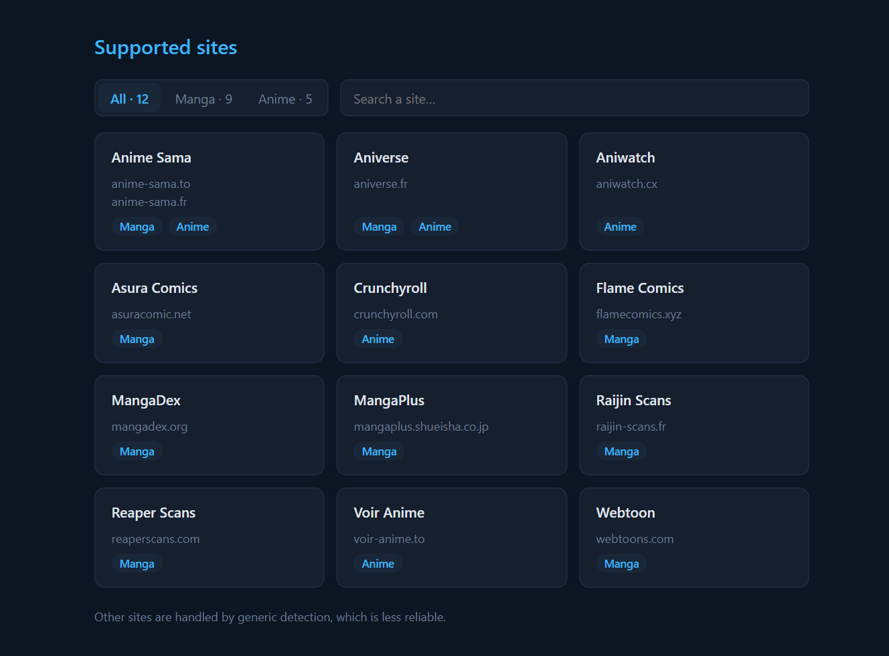
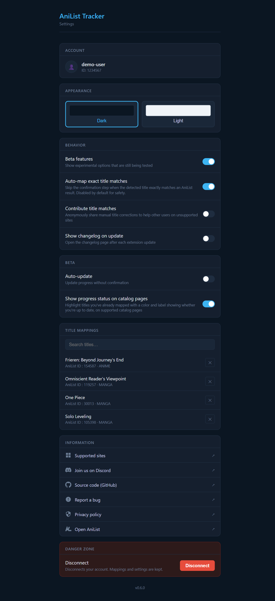
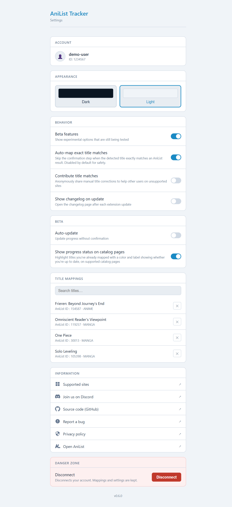
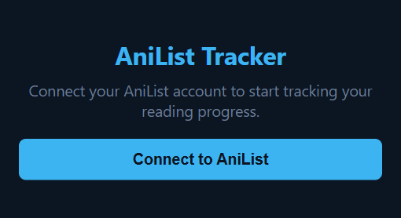
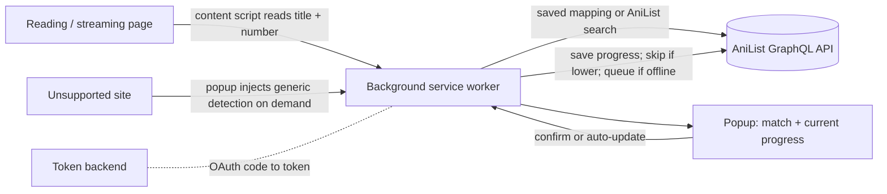

# AniList Tracker

A browser extension for Chrome and Edge that notices which manga chapter or anime episode you are on and updates your [AniList](https://anilist.co) list for you.


[](https://github.com/AnuCod3/anilist-tracker/actions/workflows/ci.yml)

> **This is a fork.** AniList Tracker was created and is maintained by **[TheNesur](https://github.com/TheNesur)** at
> [TheNesur/anilist-tracker](https://github.com/TheNesur/anilist-tracker). All credit for the extension goes to them.
> This fork ([AnuCod3/anilist-tracker](https://github.com/AnuCod3/anilist-tracker)) is used to prepare contributions back upstream.

<p align="center">
  
</p>

## What is this?

[AniList](https://anilist.co) is a free website where people keep a list of the anime they watch and the manga they read, including how far they got.
Keeping that list up to date by hand is tedious: after every chapter or episode you have to open AniList, find the title and bump the number.

AniList Tracker does this for you. While you read or watch on a supported site, it detects the title and the chapter/episode number on the page.
One click in the extension's popup (or no click at all, if you turn on auto-update) sends the new progress to your AniList account.

<details>
<summary>Contents</summary>

- [Features](#features)
- [Quick Start](#quick-start)
- [Set up with an AI assistant](#set-up-with-an-ai-assistant)
- [Usage](#usage)
- [Configuration](#configuration)
- [How it works](#how-it-works)
- [Project structure](#project-structure)
- [Development](#development)
- [Troubleshooting / FAQ](#troubleshooting--faq)
- [Status / Roadmap](#status--roadmap)
- [Credits](#credits)
- [License](#license)

</details>

## Features

- **Automatic detection**: reads the title and chapter/episode number from the page you are on. Works on [12 dedicated sites](#supported-sites) and tries a best-effort "generic" detection everywhere else.
- **One-click sync**: confirm in the popup and your AniList progress is updated without leaving the page.
- **Never goes backwards**: if AniList already has a higher number, the update is skipped instead of lowering your progress.
- **Survives connection problems**: if an update fails (for example, you are offline), it is queued and retried automatically.
- **Remembers your choices**: once a site title is linked to an AniList entry, it is recognised instantly next time. You can review and delete these links in Settings.
- **Optional extras** (off by default): auto-update without confirmation, auto-matching of exact titles, progress colours on supported catalog pages, and sharing your title corrections to help other users.
- **Dark and light theme**, **English and French** interface.
- **Privacy first**: no analytics or ads, and the extension never sees your AniList password. See [PRIVACY.md](./PRIVACY.md).

<p align="center">
  
  
</p>
<p align="center"><sub>Settings page in dark and light theme (demo account and demo data).</sub></p>

<!-- TODO(media): short GIF of the popup detecting a chapter on a real reading site and syncing it.
     Needs a real AniList login and a live third-party site, so it must be recorded manually by the owner
     with a throwaway/demo AniList account. See docs/README_MAINTENANCE.md. -->

### Supported sites

| Type | Sites |
|------|-------|
| Manga, manhwa, webtoon | MangaDex, MangaPlus, Webtoon, Asura Comics, Flame Comics, Reaper Scans, Raijin Scans, Aniverse, Anime Sama |
| Anime | Crunchyroll, Voir Anime, Anime Sama, Aniverse, Aniwatch |
| Anything else | Generic detection (page title, headings, URL). Less reliable; you confirm the result in the popup. |

The same list is built into the extension (Settings → **Supported sites**).

## Quick Start

### Option A: install from a store (recommended)

This is the easiest way and the only one where "Connect to AniList" works out of the box.

1. Open the [Chrome Web Store page](https://chromewebstore.google.com/detail/anilist-tracker/jfpamdighodolhbeepemgphglgepgcoc) (Chrome) or the [Microsoft Edge Add-ons page](https://microsoftedge.microsoft.com/addons/detail/hegknpgmdcadfdadbbadpkabndogneoi) (Edge) and click **Add**.
   You should see the AniList Tracker icon in your browser toolbar (pin it via the puzzle-piece menu).
2. Click the icon, then **Connect to AniList**, and approve access on AniList.
   You should see your AniList username in the popup.
3. Open a chapter or episode on a [supported site](#supported-sites) and click the icon.
   You should see the detected title, the chapter/episode number and a button to update AniList.

<p align="center"></p>

### Option B: build it yourself (developers)

**Prerequisites:** [Git](https://git-scm.com/downloads), [Node.js 20+](https://nodejs.org/) (CI uses 20), Chrome or Edge.

Windows PowerShell:

```powershell
git clone --recurse-submodules https://github.com/AnuCod3/anilist-tracker.git
cd anilist-tracker
npm ci
Copy-Item .env.example .env   # optional, only needed for login (see Configuration)
npm run build
```

You should see `✓ built in …` and a new `dist\` folder.

Then load it into the browser:

1. Open `chrome://extensions` (or `edge://extensions`) and switch on **Developer mode**.
2. Click **Load unpacked** and select the `dist` folder.
   You should see "AniList Tracker 0.6.0" in the list and its icon in the toolbar.

> A self-built extension shows all pages and runs detection, but **Connect to AniList only works with your own AniList API client and token backend** (see [Configuration](#configuration)). To simply use the extension, install it from a store.

<details>
<summary>macOS / Linux</summary>

```bash
git clone --recurse-submodules https://github.com/AnuCod3/anilist-tracker.git
cd anilist-tracker
npm ci
cp .env.example .env   # optional
npm run build
```

Load `dist/` as an unpacked extension as described above.
</details>

## Set up with an AI assistant

Open this folder in Claude Code, Codex, Gemini CLI or Cursor and paste:

```text
Read AGENTS.md and README.md in this repository. Set the project up on my machine:
check that Node.js 20+ and Git are installed, make sure the git submodule
src/shared/anilist-tracker-shared is checked out, install dependencies with npm ci,
create .env from .env.example (ask me for the AniList client ID, redirect URI and
token endpoint, never invent them; leave them empty if I only want to try the UI),
run the type check and the build, then tell me step by step how to load the dist
folder as an unpacked extension in Chrome or Edge.
```

## Usage

| I want to… | Do this |
|---|---|
| Update my progress | Open a chapter/episode on a supported site → click the toolbar icon → confirm the update. |
| Fix a wrong match | In the popup, search for the right AniList entry and pick it. The choice is remembered for that site title. |
| Track on an unsupported site | Click the icon. Generic detection guesses the title and number and asks whether it is anime or manga. |
| Skip the confirmation | Settings → **Beta features** on → **Auto-update** on. |
| Forget a remembered match | Settings → **Title mappings** → click ✕ next to the title. |
| Report a problem | Use the report option in the popup (wrong match, title not found, site not working). |

## Configuration

Only needed when you build the extension yourself. Values go into `.env` (copied from [`.env.example`](./.env.example)) and are baked in at build time.

| Variable | Required | What it does | Where to get it |
|---|---|---|---|
| `VITE_ANILIST_CLIENT_ID` | For login | ID of the AniList API client used for OAuth (secure sign-in without sharing your password). | Create a client at [anilist.co/settings/developer](https://anilist.co/settings/developer). |
| `VITE_ANILIST_REDIRECT_URI` | For login | Redirect URL registered on that client. It points to the token backend, not the extension. | Your backend's callback URL. |
| `VITE_TOKEN_ENDPOINT` | No | Backend URL that exchanges the login code for a token. Defaults to the upstream author's backend. | Your own token backend (the upstream backend repository is not public). |

The AniList client **secret** never goes into the extension; it lives only on the backend. The build also works with all three values empty, but login won't.

## How it works



1. A **content script** (code the extension runs inside supported pages) reads the title and chapter/episode number.
2. The **background service worker** finds the AniList entry: first your saved title mappings, then an AniList search, optionally the community title database.
3. The **popup** shows the match and your current AniList progress. You confirm, or it updates automatically.
4. The update goes to the AniList GraphQL API. Lower numbers are skipped; failed updates are queued and retried.
5. Sign-in uses OAuth through a small backend run by the upstream author, so the client secret never ships in the extension.

## Project structure

```text
src/
├── background/   service worker: OAuth, AniList calls, progress queue, title aliases, toolbar badge
├── content/      scripts injected into supported sites (detection + optional catalog overlay)
├── parsers/      one parser per site (manga/, anime/, catalog/) + parser factory
├── popup/        toolbar popup UI and generic detection for unsupported sites
├── options/      settings page
├── sites/        "Supported sites" page and the site registry
├── shared/       git submodule anilist-tracker-shared (title normalisation)
└── utils/        AniList GraphQL client, storage, i18n, matching
public/           manifest.json, icons, changelog page
_locales/         English and French UI strings
scripts/          capture-readme-media.mjs (README screenshots)
```

## Development

| Command | What it does |
|---|---|
| `npm ci` | Install exact dependency versions. |
| `npm run typecheck` | TypeScript check (`tsc --noEmit`). This is the project's check; there is no unit test suite. |
| `npm run build` | Production build into `dist/`. |
| `npm run build:dev` | Dev build: dev icons, extra dev auth host, and a stable extension ID if `dev-key.txt` exists. |
| `npm run build:store` | Build and zip for store upload (needs a `zip` command, e.g. from Git Bash or WSL on Windows). |
| `node scripts/capture-readme-media.mjs` | Regenerate the README screenshots (see [docs/README_MAINTENANCE.md](./docs/README_MAINTENANCE.md)). |

CI ([`.github/workflows/ci.yml`](./.github/workflows/ci.yml)) runs `npm ci`, `npm run typecheck` and `npm run build` on pushes and pull requests to `main`.

<details>
<summary>Adding a new site</summary>

1. Create a parser in `src/parsers/manga/` or `src/parsers/anime/` implementing `SiteParser` (`src/types/index.ts`).
2. Add the site id to `SupportedSite` in `src/types/index.ts`.
3. Register the parser in `src/parsers/index.ts` → `getParser()`.
4. Add the hostnames and display name to `src/sites/registry.ts`.
5. Add the URL patterns to `content_scripts.matches` in `public/manifest.json`.

Optional catalog status overlay: implement `CatalogParser` in `src/parsers/catalog/` and register it in `src/parsers/catalog/index.ts`. Use the same title cleaning as the site's chapter parser so saved mappings match.
</details>

See [CONTRIBUTING.md](./CONTRIBUTING.md) for code style and branch rules, and [SECURITY.md](./SECURITY.md) for reporting vulnerabilities.

## Troubleshooting / FAQ

<details>
<summary><b>Build fails with "Cannot find module '../shared/anilist-tracker-shared/index.js'"</b></summary>

The shared submodule is missing. Run `git submodule update --init --recursive`, or clone with `--recurse-submodules`.
</details>

<details>
<summary><b>"Connect to AniList" fails on my self-built extension</b></summary>

Login needs `VITE_ANILIST_CLIENT_ID` and `VITE_ANILIST_REDIRECT_URI` at build time, plus a token backend that accepts your extension. Fill in `.env`, rebuild, and reload the extension. If you only want to use the extension, install it from a store.
</details>

<details>
<summary><b>The popup says the page is not supported, or detection failed</b></summary>

Make sure you are on an actual chapter/episode page, not the series overview. Sites change their layout often, which can break a parser. Use the report option in the popup so the maintainer can fix it.
</details>

<details>
<summary><b>It matched the wrong anime or manga</b></summary>

Pick the right entry in the popup's search results. To undo a remembered match, delete it under Settings → Title mappings.
</details>

<details>
<summary><b>My code changes don't show up</b></summary>

Rebuild (`npm run build`) and click the reload icon on the extension card in `chrome://extensions`. Reload the site tab too, so the content script is re-injected.
</details>

## Status / Roadmap

- **Released:** version 0.6.0 is on the Chrome Web Store and Edge Add-ons. `main` in this fork mirrors upstream `main`.
- **In progress (not on `main` yet):** donghua (Chinese animation) streaming-site parsers, a multi-season episode resolver and a reminder cue in the popup live on branch [`feat/donghua-multi-season-support`](https://github.com/AnuCod3/anilist-tracker/tree/feat/donghua-multi-season-support). They are proposed upstream in [TheNesur/anilist-tracker#12](https://github.com/TheNesur/anilist-tracker/pull/12) and [#13](https://github.com/TheNesur/anilist-tracker/pull/13).

## Credits

- **[TheNesur](https://github.com/TheNesur)**: author and maintainer of AniList Tracker, its token backend and the [shared library](https://github.com/TheNesur/Anilist-tracker-shared). Please star the project and report issues at the [upstream repository](https://github.com/TheNesur/anilist-tracker).
- [AniList](https://anilist.co) for the public GraphQL API.
- Built with TypeScript, [Vite](https://vite.dev/) and [CRXJS](https://github.com/crxjs/chrome-extension-tools).

## License

MIT, see [LICENSE](./LICENSE). Copyright (c) 2026 TheNesur.
